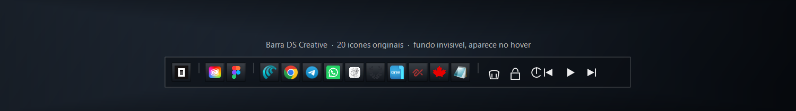
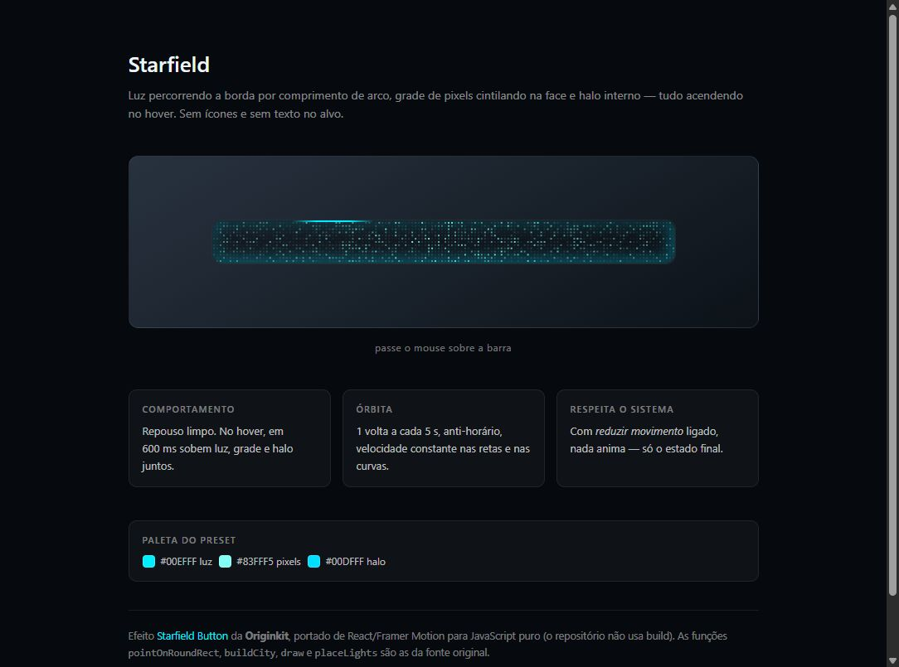

<div align="center">

# 🛠️ Barra DS Creative

**Uma barra de lançamento minimalista e de flutuação livre para o Windows 11.**
Deitada ou em pé, do tamanho que você quiser, na cor que você escolher.

Feita como mod do [Windhawk](https://windhawk.org). Sem emoji, sem firula —
só traços finos, ícones originais e atalhos onde importam.



</div>

---

## O que ela faz

Uma única linha flutuando sobre a área de trabalho, com **19 atalhos** divididos
em grupos por linhas de 1px:

```
[OpenCode] │ [Adobe▸] [Figma] │ [Comet][Chrome][Telegram][WhatsApp][NeverWrite][Arena][OneCommander][alphaXiv][Maple][Notepad] │ [🗑][🔒][⏻] │ [⏮][▶][⏭]
```

| Grupo | Conteúdo |
|---|---|
| **OpenCode** | Abre o Windows Terminal na sua pasta de projeto e retoma a última sessão |
| **Adobe** | Um botão só — o Creative Cloud abre um painel com Photoshop, Illustrator, After Effects, Premiere e Lightroom |
| **Atalhos** | Os programas do dia a dia — uma lista que você edita nas configurações, até 32 itens |
| **Sistema** | Esvaziar lixeira, bloquear, desligar |
| **Mídia** | Anterior, tocar/pausar, próxima — funciona com qualquer player |

### Deitada ou em pé

A barra deitada mede **672×44**. Em pé mede **46×671** — a mesma barra com os
eixos trocados, e os separadores deitam junto. Medido com o mod rodando, não
estimado.

Em pé, o painel do Creative Cloud abre **ao lado** da barra em vez de abrir
acima: em pé não sobra espaço vertical, e o painel seria cortado pela borda da
tela.

### O fundo fica

A barra tem fundo **sempre visível**, com o tema, a textura e a opacidade que
você escolher. Passar o mouse por cima não troca o tema, não acende a barra e não
mexe na opacidade: o único movimento é o dos ícones, no efeito magnético.

### Efeito magnético nos ícones

Os ícones **crescem perto do cursor e voltam ao normal sozinhos**, como um dock
magnético. O ícone sob o cursor chega a **1,5 vez** o tamanho; os vizinhos crescem
menos, na proporção exata da distância, e tudo se acomoda em cerca de um quinto de
segundo.

O ícone cresce **dentro da barra**: ela não estica, não empurra os vizinhos de
lugar e a posição de cada botão nunca muda — o clique continua caindo onde sempre
caiu. Funciona igual deitada ou em pé.

Medido com o mod rodando, cursor no meio da barra: o ícone sob o cursor mediu
**34px contra 22px** em repouso, os dez botões fora do alcance ficaram em 1,000
exato, e a conta do mod bateu com o tamanho na tela com **0,009 de erro médio**
em 18 botões. Desligar o efeito devolve todos os botões a 1,000 exato.

### Clique em qualquer lugar, arraste segurando

**A barra inteira é área de clique.** Não existe zona morta: clicar 1px acima ou
abaixo de um ícone ativa o mesmo botão. Medido na 1.0.6 — antes disso, 13 dos 44
pixels de altura engoliam o clique em silêncio e a barra era arrastada no lugar.

Para **arrastar**, segure e mova mais de 4px. O tremor natural da mão não cancela
mais o clique, e um clique nunca move a barra sem querer.

A barra é de **flutuação livre**: arraste para qualquer lugar da tela. Ela guarda
a posição e volta para o mesmo lugar depois de reiniciar o explorer.

---

## Configurações

O Windhawk gera a tela de controle automaticamente. Tudo aplica **em tempo real**,
sem reiniciar nada.

### Temas de cor

Cada tema é um trio: cor do fundo, cor dos traços e cor da divisória. Trocar o
tema troca a barra inteira de uma vez.

| | | |
|---|---|---|
| **Personalizado** — usa as três cores soltas dos ajustes | **Escuro** — o visual de sempre | **Preto total** |
| **Grafite** | **Ardósia** | **Verde-noite** |
| **Vinho** | **Âmbar** | **Claro** |
| **Papel** | | |

Nos temas claros os **traços dos ícones ficam escuros**. Não é enfeite: traço
branco sobre fundo claro some. Medido — no tema Claro o fundo sai em `76,76,76` e
o traço mais escuro em `17`; no tema Preto total o fundo sai em `7,7,7` e o
traço mais claro em `255`.

As três cores do tema Personalizado aceitam `#RRGGBB` ou `RRGGBB`. Escrita
errada não quebra nada: cai no padrão.

### Escala da barra

De **70% a 150%**, em sete degraus. Muda tudo junto — botões, ícones, cantos,
espaçamentos e a área de clique. Os ícones de traço fino são desenhados de novo
no tamanho certo, então não ficam borrados.

### Atalhos de programas

Os programas da barra são **uma lista editável** nas configurações — os dez que
já vêm prontos e os que você acrescentar. Cada item é um atalho em três campos
separados por `|`:

```
Nome | Alvo | Ícone
```

O **Alvo** aceita o que o Windows abre: programa (`.exe`), pasta, documento ou
site. Com argumentos, o programa vai entre aspas — é assim que o Maple Bookmarks
abre os seus favoritos salvos numa janela do Comet:

```
Maple Bookmarks | "C:\Program Files\Perplexity\Comet\Application\comet.exe" --app="chrome-extension://..." | maple
```

Apps da Microsoft Store entram pelo atalho do Windows:

```
WhatsApp | shell:AppsFolder\5319275A.WhatsAppDesktop_cv1g1gvanyjgm!App | whatsapp
```

O **Ícone** é opcional: o nome de um PNG da pasta de ícones (`chrome`, `maple`,
`telegram`…) ou um arquivo de onde tirar o ícone. Em branco, o ícone é
**extraído do próprio alvo** — nada de ícone desenhado. Se a extração falhar,
aparece um marcador de contorno fino, para o botão nunca ficar invisível.

Na tela de configurações, o **+** acrescenta um atalho e a lixeira tira. Um item
começando com `//` fica desligado sem precisar ser apagado:

```
// Telegram | D:\Telegram Desktop\Telegram.exe | telegram
```

### Posição

| Ajuste | O que faz |
|---|---|
| **Barra em pé** | Deita ou levanta a barra inteira |
| **Colar nas bordas** | Ao soltar, a barra encosta na borda mais próxima (28px de margem). Arrastar além da borda também encosta |
| **Travar no lugar** | A barra não sai do lugar. O clique continua funcionando normalmente |
| **Manter na área de trabalho** | A barra nunca fica fora da área visível. Vale também quando a resolução muda ou um monitor é desconectado |
| **Ficar por cima das janelas** | Ligado, a barra flutua sobre os programas abertos. Desligado (padrão), ela vive na área de trabalho e as janelas passam por cima dela |

Se você travar a barra fora da tela, ligar **Manter na área de trabalho** traz ela
de volta.

Por padrão a barra **mora na área de trabalho**: fica na frente do papel de parede
e atrás dos programas. Abrir ou maximizar uma janela cobre a barra, e ela reaparece
quando a área de trabalho aparece. Ligue **Ficar por cima das janelas** para ela
ficar sempre à vista, sobre tudo. Durante um arraste ela vai para a frente de
propósito — é onde você precisa ver para escolher o lugar — e volta para a camada
escolhida assim que você solta.

### 10 texturas procedurais

Desenhadas em GDI+ na hora — sem arquivo de imagem, quase nada de peso. Todas
acompanham a cor do tema escolhido.

| | | | |
|---|---|---|---|
| Nenhuma | Vidro fosco | Fibra de carbono | Metal escovado |
| Perfurado | Linho | Papel | Diagonais |
| Malha | Granulado | | |

### Opacidade

Deslizador de **10% a 100%**, aplicado só ao fundo. Os ícones e as linhas ficam
sempre em 100%, então a barra nunca perde legibilidade por estar transparente.

### Efeito magnético

| Ajuste | O que faz |
|---|---|
| **Efeito magnético nos ícones** | Liga e desliga a atração. Vem ligado |
| **Força do efeito magnético (%)** | Quanto o ícone sob o cursor cresce. 100 = 1,5 vez, até 200 |
| **Alcance do efeito magnético (px)** | Até onde os vizinhos sentem o cursor. Padrão 150 |

O alcance é medido no tamanho 100% e **acompanha a Escala**: em 150% ele alcança
os mesmos botões de sempre, só que maiores. Força 0 deixa a barra parada sem
precisar desligar o efeito.

### Mais

- Cor do fundo, dos traços e da divisória (no tema Personalizado)
- Pasta de trabalho do OpenCode
- Pasta de ícones

---

## Efeito Starfield (fora do mod)

O mod **não tem mais** o efeito de hover antigo. Antes a barra era limpa no
repouso e acendia ao passar o mouse — luz percorrendo a borda, grade de pixels
cintilando e halo interno subindo em 600 ms. Isso trocava o visual inteiro a cada
movimento do mouse e foi removido. O que existe hoje no lugar é o **efeito
magnético dos ícones**, descrito acima — a barra em si continua parada.

O efeito continua no repositório como **demo avulso**, sem relação com o mod:

**[`starfield.html`](starfield.html)** — abra direto no navegador e passe o mouse.



É o
[Starfield Button](https://www.originkit.dev/components/starfield-button)
da **Originkit**, portado de React/Framer Motion para JavaScript puro — o
repositório não tem build. As funções `pointOnRoundRect`, `buildCity`, `draw` e
`placeLights` são as da fonte original, não uma reescrita.

Ciano do preset: `#00EFFF` luz · `#83FFF5` pixels · `#00DFFF` halo.

---

## Instalação

1. Instale o [Windhawk](https://windhawk.org) se ainda não tiver
2. Abra o Windhawk → **Mods** → **Create new mod**
3. Cole o conteúdo de [`dscreative-bar.wh.cpp`](dscreative-bar.wh.cpp) e salve
4. O Windhawk compila com o MinGW embutido e instala
5. A barra aparece na hora — não precisa reiniciar nada

> O arquivo [`dscreative-bar.wh.cpp`](dscreative-bar.wh.cpp) é o mod completo.
> Compila sem nenhum erro e sem nenhum aviso com clang 20 / `-Wall -Wextra`.
> A especificação que o originou está em [`SPEC.md`](SPEC.md) — ela descreve o
> desenho original, incluindo o efeito de hover que foi removido depois.

---

## Ícones

Este repositório **não distribui nenhum ícone**. Os ícones dos programas são marcas
registradas da Adobe, Google, Meta, Telegram, Perplexity e de outros.

Cada pessoa extrai os ícones **dos programas que já estão instalados na máquina
dela**:

```powershell
powershell -NoProfile -ExecutionPolicy Bypass -File .\extrair-icones.ps1
```

O script:

- Lê o ícone real de cada `.exe` instalado
- Resolve caminhos que mudam de versão (Figma, WhatsApp) sozinho
- Baixa os favicons dos sites que não são programa (OpenCode, alphaXiv)
- Remove o fundo branco só onde ele encosta na borda — preservando os glifos
  internos, como a letra do Photoshop e o telefone do WhatsApp
- Gera `icons\` e `icons\b64.txt`

Os **atalhos de programas** não passam por esse script: o ícone sai do PNG que
você indicar na lista ou, sem ele, do próprio alvo do atalho.

---

## Requisitos

| Item | |
|---|---|
| Sistema | Windows 11 |
| Mod | [Windhawk](https://windhawk.org) 1.5+ |
| Terminal | Windows Terminal (para o botão do OpenCode) |
| Permissões | Nenhuma especial — roda sem elevação |

---

## Limitações conhecidas

- **Caminhos com versão no nome** (Figma, WhatsApp) são resolvidos em runtime;
  se o programa sumir, o botão não acha
- **Maple Bookmarks** abre os favoritos numa janela do Comet — a extensão é do
  Comet, então sem ele a janela não abre
- **Desligar** pede confirmação, e o Windows mostra aviso de UAC
- **Manter na área de trabalho** com o **colar nas bordas** desligado é a única
  combinação que deixa a barra sair da tela. É de propósito: é o que permite
  encostar metade dela fora, se você quiser

---

## Especificação

O documento completo de design e comportamento está em **[`SPEC.md`](SPEC.md)** —
janela, layout, ações, esquema de configuração, texturas, persistência e
critérios de aceite.

---

## Apoie o projeto

Se isso te poupar tempo, **paga um café** ☕

**Pix (Mercado Pago):**

```
diogogg27@gmail.com
```

<div align="center">

Obrigado por qualquer coisa — de verdade.

</div>

---

## Licença

MIT — use, modifique, distribua.

Os ícones dos programas citados pertencem aos seus respectivos donos e **não**
são distribuídos aqui.

---

<div align="center">
Feito por <b>Diogo Santos</b> · DS Creative
</div>
